<p align="center">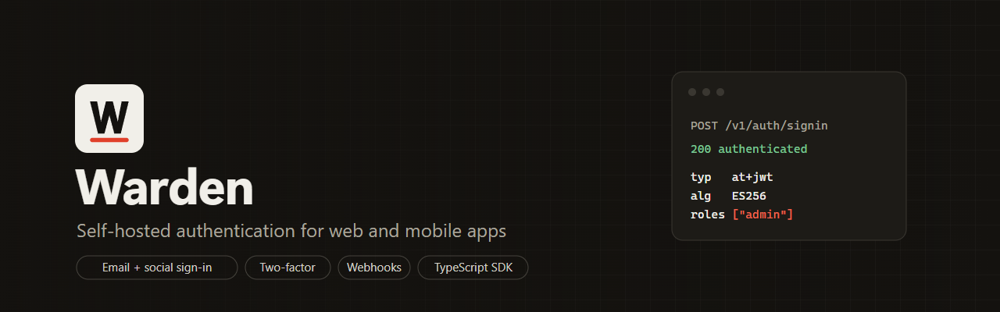</p>

# Warden

A self-hosted authentication service in Go. Run one instance per product and every backend you write (Go, Node.js, Python, anything) gets sign-up, sign-in, social login, MFA and sessions without reimplementing them.

Warden issues short-lived **ES256 JWT access tokens** that your services verify offline against a public JWKS endpoint, plus **rotating refresh tokens** with theft detection. Social providers (Google, Apple, GitHub, Discord) are switched on and off from a private admin UI, without touching code or restarting.

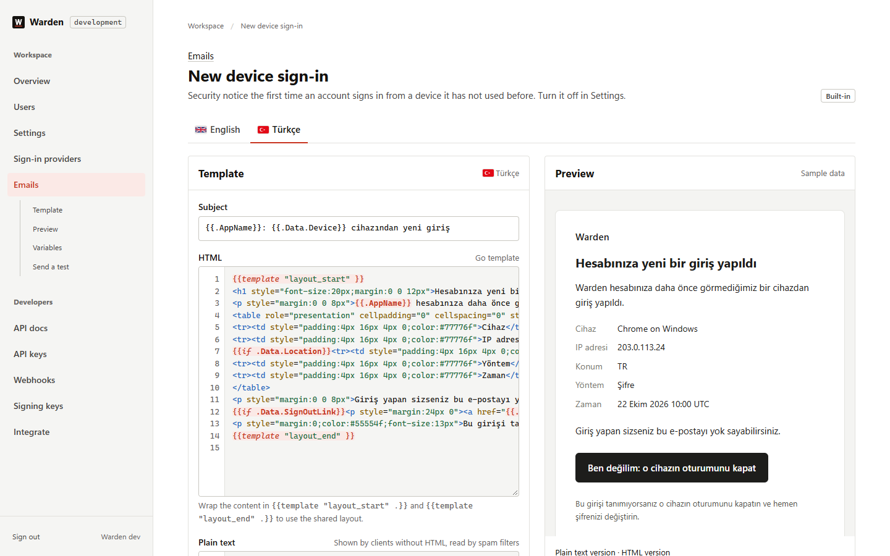

## Contents

- [Features](#features)
- [Quick start](#quick-start)
- [How it fits into your stack](#how-it-fits-into-your-stack)
- [Admin UI](#admin-ui)
- [Using Warden from your apps](#using-warden-from-your-apps)
- [API overview](#api-overview)
- [Configuration](#configuration)
- [Security model](#security-model)
- [Performance and resilience](#performance-and-resilience)
- [Observability](#observability)
- [Development](#development)
- [Project layout](#project-layout)
- [Contributing](#contributing)
- [License](#license)

## Features

**Authentication**
- Email and password with Argon2id (OWASP parameters), optional [Have I Been Pwned](https://haveibeenpwned.com/API/v3#PwnedPasswords) breach check
- Social sign-in: Google, Apple, GitHub, Discord. Browser flow with PKCE for web and mobile, plus **native ID token sign-in** for Sign in with Apple and Google Sign-In on iOS/Android
- TOTP two-factor authentication with single-use codes and recovery codes
- Email verification and password reset with single-use, expiring links
- Safe account linking that blocks pre-account takeover
- Security emails like hosted providers send: sign-in from a new device (with a button that ends that session), account locked after failed attempts, password and two-factor changes
- Emails in the user's language (English and Turkish built in), chosen from the app, the browser or the admin UI

**Sessions and tokens**
- ES256 access tokens (RFC 9068 `at+jwt`), JWKS and OpenID discovery documents
- Opaque refresh tokens, rotated on every use, with reuse detection that revokes the whole session
- Automatic signing key rotation with zero downtime
- Session list and remote sign-out per device; cookie mode (HttpOnly) for browser apps

**For your apps**
- [`warden-auth`](https://github.com/fatihacan1/warden-js): zero-dependency TypeScript SDK for web, React Native and Node.js, with example account screens
- Publishable keys (per app, bound to origins) and secret keys (per backend) managed in the admin UI
- Server API for backends: create users (including the first admin), set roles, disable, sign out, introspect tokens
- Webhooks for `user.created`, `user.updated` and every other event, signed per [Standard Webhooks](https://www.standardwebhooks.com), retried per endpoint
- Optional GraphQL endpoint with depth, size and introspection limits
- API docs inside the admin UI with working examples for your instance, and the OpenAPI file to download
- Access tokens for automation and AI agents: per-resource read/write permissions, 1 hour to 90 days, optional IP ranges, plus a built-in MCP server (`warden mcp`) so Claude can manage users, email templates, webhooks and settings within those limits

**Operations**
- Setup wizard (`warden setup`): a step-by-step onboarding that tests database, Redis, SMTP, S3 and RabbitMQ before moving on, generates secrets, picks the encryption algorithm and writes `.env`
- Private admin UI: feature toggles, provider credentials, users, sessions, keys, email templates in a code editor with live preview, optional IP allowlist
- Internal gRPC API for service-to-service calls (verify token, users, roles, disable, revoke), with optional TLS 1.3 and mutual TLS
- Service-to-service authentication with the OAuth 2.0 client credentials grant: microservices get short-lived JWTs, verifiable offline with the JWKS, scoped and audience-bound, with secret rotation without downtime
- Domain events to RabbitMQ through a transactional outbox (`user.created`, `user.signed_in`, ...)
- Avatar uploads to any S3-compatible store (AWS S3, Garage, Cloudflare R2, MinIO, Backblaze B2)
- Encryption at rest with AES-256-GCM or XChaCha20-Poly1305, key rotation without downtime (`warden reencrypt`)
- Prometheus metrics with ready alert rules and a Grafana dashboard, structured JSON logs, Sentry error reporting, health and readiness probes
- Load shedding, bounded password hashing, distributed rate limiting, graceful shutdown

## Quick start

Requirements: Docker Desktop (or Docker Engine with Compose v2). Go 1.26+ only for development.

**Guided:** `go run ./cmd/warden setup` (or `make setup`) prints a link to a local page that walks you through each connection, tests it, generates secrets and writes `.env`. Then `docker compose up -d --build`.

**Kubernetes:** Kustomize manifests for kind and production are in [deploy/kubernetes](deploy/kubernetes); see [docs/kubernetes.md](docs/kubernetes.md).

| 1. Welcome | 2. Each connection tested | 3. Review, then write `.env` |
| --- | --- | --- |
| 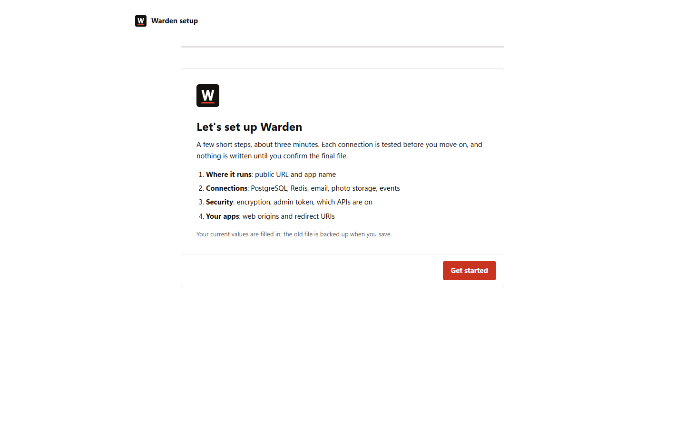 | 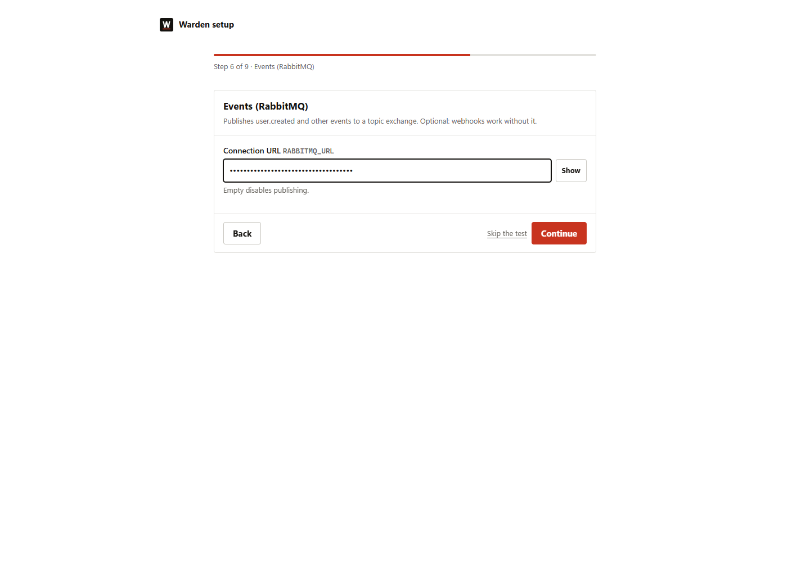 | 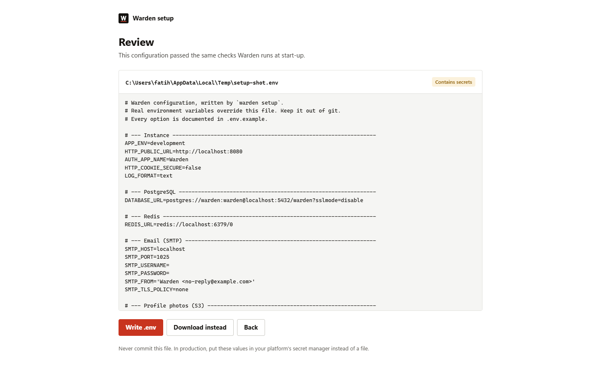 |

**Manual:**

```bash
git clone https://github.com/fatihacan1/warden.git
cd warden
cp .env.example .env
docker compose up -d --build
```

| What | URL |
| --- | --- |
| Public API | http://localhost:8080 |
| Admin UI (token: `ADMIN_TOKEN` in `.env`) | http://localhost:9090 |
| Mailpit, catches every email | http://localhost:8025 |
| RabbitMQ management (`warden` / `warden`) | http://localhost:15672 |
| Garage Web UI (S3 browser) | http://localhost:3909 |

Create an account and call an authenticated endpoint:

```bash
curl -s localhost:8080/v1/auth/signup -H 'Content-Type: application/json' \
  -d '{"email":"ada@example.com","password":"correct horse battery staple","name":"Ada"}'

curl -s localhost:8080/v1/me -H "Authorization: Bearer <access_token from the response>"
```

**On a server, without a domain or SMTP provider:** [docs/test-server.md](docs/test-server.md) sets up HTTPS on a free `sslip.io` address and an admin Inbox for emails in one command.

Prefer a guided setup? `go run ./cmd/warden setup` opens a local page that tests each connection, generates secrets and writes `.env` for you.

The values in `.env.example` are public development defaults. Warden refuses to start with them when `APP_ENV=production`; generate your own with `docker compose run --rm --no-deps warden keygen` or `go run ./cmd/warden keygen`.

## How it fits into your stack

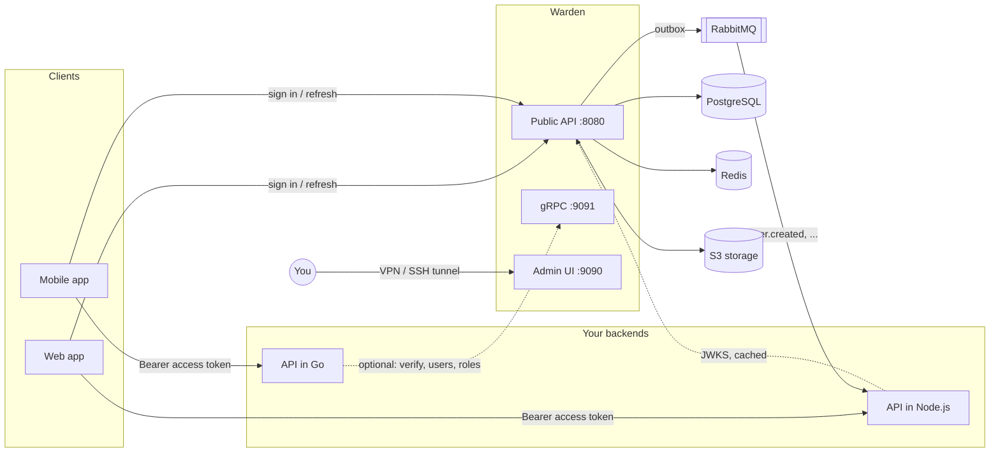

- **Clients** talk to Warden only to sign in, refresh and manage their account.
- **Your APIs never call Warden per request.** They verify the access token signature with the cached JWKS, which costs microseconds and keeps working if Warden is briefly down.
- **Events** let other services react (create a profile on `user.created`, clean up on `user.deleted`).
- **The admin port is private.** It is bound to `127.0.0.1` in Compose; in production reach it through a VPN, an SSH tunnel or your cluster network.

Run **one Warden instance per product** (its own database and Redis DB). Users, keys and settings are then fully isolated between products, the same model Clerk uses for "instances".

## Admin UI

The admin UI is how you configure an instance: switch features and providers on or off, paste provider keys, and look after users. It is server rendered, has no external dependencies and works on a phone.

| Overview | User |
| --- | --- |
| 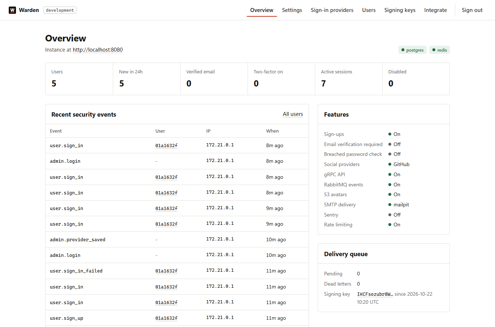 | 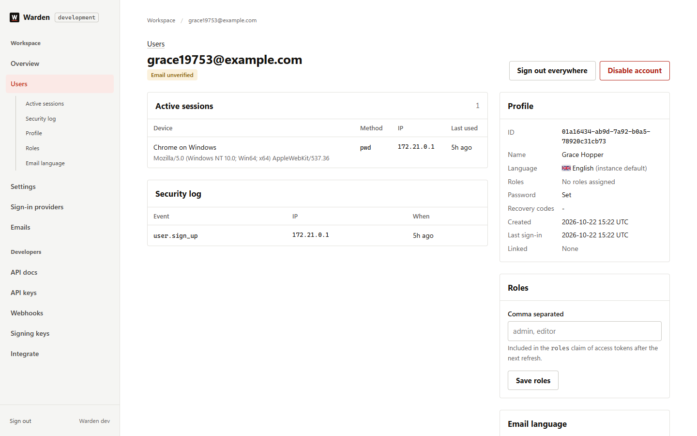 |
| **API docs** | **Webhooks** |
| 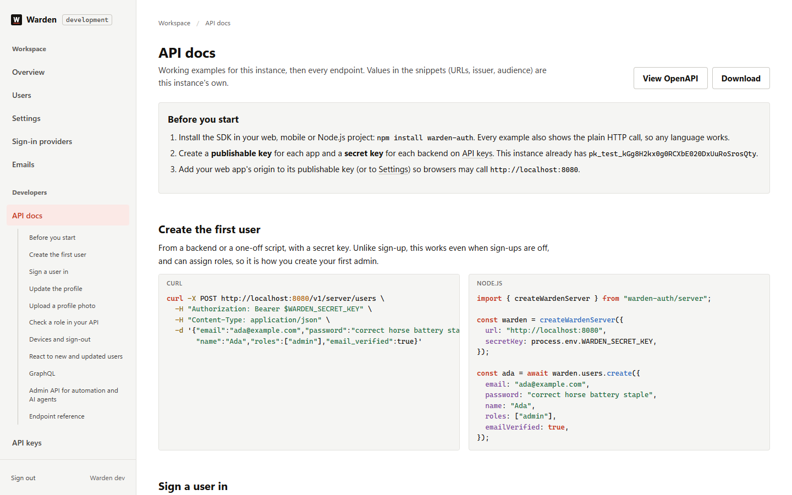 | 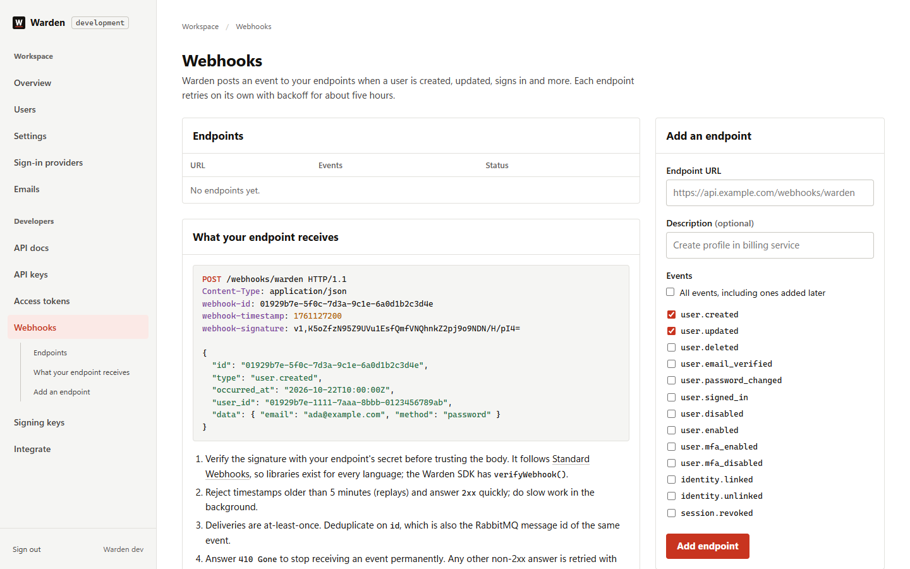 |
| **API keys** | **Settings** |
| 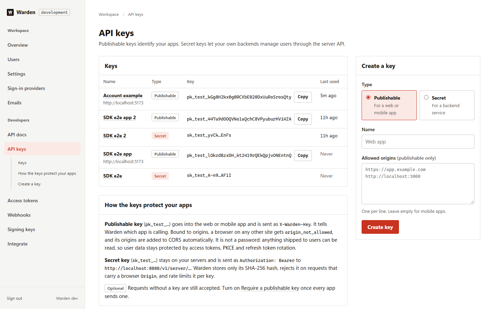 | 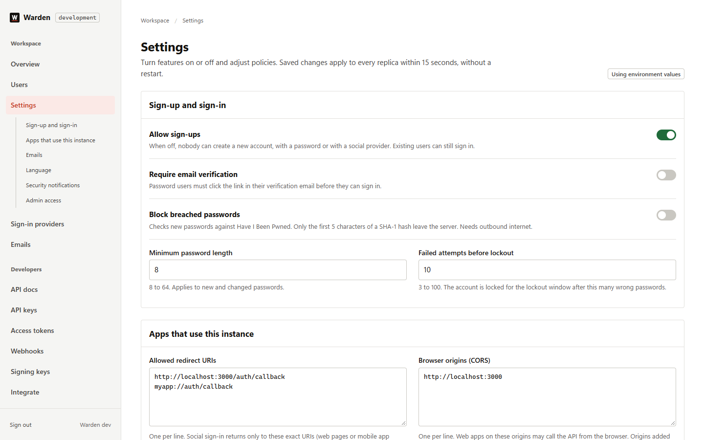 |
| **Access tokens (AI agents)** | **Emails** |
| 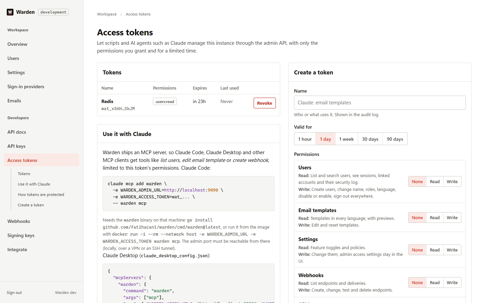 |  |

- **Settings**: sign-ups, email verification, breached password check, password length, lockout, app name, email links, redirect URIs, CORS origins, publishable key enforcement, default email language, security notifications, admin IP allowlist. Applied to every replica within 15 seconds.
- **Sign-in providers**: enable Google, Apple, GitHub or Discord and paste their credentials. The page shows the exact callback URL to register with each provider. Secrets are encrypted at rest and never displayed again.
- **Users**: search with numbered pages, sessions per device, security log, roles, email language (with flags), disable, sign out everywhere.
- **Emails**: every email and the shared layout, per language. Subject, HTML and plain text are edited in code editors with line numbers, HTML and template highlighting and click-to-insert variables; a sandboxed preview renders sample data, and you can send yourself a test. Broken templates are rejected before they are saved.
- **API docs**: working examples (create the first user, sign in, update the profile, upload a photo, check a role, webhooks, GraphQL) with this instance's values, and the endpoint reference generated from the OpenAPI file, which you can download.
- **API keys**: publishable keys for apps (bound to origins) and secret keys for backends; secrets are shown once.
- **Access tokens**: scoped, expiring tokens for the admin API and the MCP server (Claude Code, Claude Desktop). Tokens cannot create tokens or change admin access.
- **Webhooks**: endpoints, event selection, signing secrets, recent deliveries with retry.
- **Signing keys**: current key, rotation schedule, rotate now.
- **Integrate**: issuer, audience, JWKS URL and copy-paste verification snippets for this instance.

Environment variables are the defaults; values saved in the UI override them and can be reset. Connections and secrets (database, Redis, S3, SMTP, encryption key) stay in the environment on purpose: they hold credentials and need a restart.

Access is protected by `ADMIN_TOKEN` (32+ characters) and, optionally, an IP allowlist (Settings > Admin access; turning it on always adds your own address, and `ADMIN_IP_ALLOWLIST_DISABLED=true` gets you back in). Restrict the port at the network level first: VPN, SSH tunnel or a firewall rule. The allowlist is a second layer. Sessions are HttpOnly, `SameSite=Strict`, CSRF protected, bound to the current token (rotating the token signs every admin out), and every action is written to the audit log. Leave `ADMIN_TOKEN` empty to disable the UI entirely; `/metrics` and `/healthz` stay available on that port.

## Using Warden from your apps

With the SDK (`npm install warden-auth`), in a web or React Native app:

```ts
import { createWarden } from "warden-auth";

const warden = createWarden({ url: "https://auth.example.com", publishableKey: "pk_live_...", mode: "cookie" });

await warden.signIn({ email, password });
await warden.user.update({ name: "Ada Lovelace" });
await warden.user.uploadAvatar(file);
const res = await warden.fetch("https://api.example.com/orders"); // access token attached and refreshed
```

and in your API:

```ts
import { createWardenServer } from "warden-auth/server";

const warden = createWardenServer({ url: "https://auth.example.com", secretKey: process.env.WARDEN_SECRET_KEY });
app.get("/admin/reports", warden.express({ roles: ["admin"] }), handler);
```

Without the SDK, the short version for an Express API:

```js
import { createRemoteJWKSet, jwtVerify } from "jose";

const JWKS = createRemoteJWKSet(new URL("https://auth.example.com/.well-known/jwks.json"));

export async function requireAuth(req, res, next) {
  try {
    const token = req.headers.authorization?.replace(/^Bearer /i, "");
    const { payload } = await jwtVerify(token, JWKS, {
      issuer: "https://auth.example.com",
      audience: "warden",
      algorithms: ["ES256"],
      typ: "at+jwt",
    });
    req.user = { id: payload.sub, roles: payload.roles ?? [] };
    next();
  } catch {
    res.status(401).json({ error: "invalid_token" });
  }
}
```

[docs/integration.md](docs/integration.md) covers the rest: web apps (cookie mode), mobile apps (PKCE browser flow and native Apple/Google), refresh handling, consuming events, the gRPC client and setting up each identity provider.

## API overview

Full schema: [api/openapi.yaml](api/openapi.yaml). Errors always look like `{"error": {"code": "invalid_credentials", "message": "...", "request_id": "..."}}`.

| Method | Path | Purpose |
| --- | --- | --- |
| GET | `/v1/auth/providers` | Enabled sign-in methods and public settings |
| POST | `/v1/auth/signup` | Create a password account |
| POST | `/v1/auth/signin` | Sign in; may answer `mfa_required` |
| POST | `/v1/auth/mfa/verify` | Complete sign-in with a TOTP or recovery code |
| POST | `/v1/auth/refresh` | Rotate the refresh token, get a new access token |
| POST | `/v1/auth/signout` | Revoke the current session |
| POST | `/v1/auth/email/verify` | Confirm an email address |
| POST | `/v1/auth/password/forgot` | Send a reset link (always 202) |
| POST | `/v1/auth/password/reset` | Set a new password with a reset token |
| GET | `/v1/oauth/{provider}/authorize` | Start social sign-in (PKCE) |
| GET/POST | `/v1/oauth/{provider}/callback` | Provider callback (POST for Apple) |
| POST | `/v1/oauth/token` | Exchange the one-time login code for tokens; with `grant_type=client_credentials`, get a service token (OAuth 2.0 client credentials) |
| POST | `/v1/oauth/{provider}/native` | Native Apple/Google ID token sign-in |
| GET, PATCH, DELETE | `/v1/me` | Profile, update name, delete account |
| POST | `/v1/me/password` | Change or set password |
| POST | `/v1/me/email/resend` | Resend verification email |
| PUT, DELETE | `/v1/me/avatar` | Upload (multipart `file` or raw body) or remove avatar |
| GET, DELETE | `/v1/me/sessions[/{id}]` | List sessions, sign out one or all other devices |
| GET, DELETE | `/v1/me/identities[/{provider}]` | Linked social accounts |
| POST | `/v1/me/mfa/totp/setup`, `/enable`, `/disable` | Manage two-factor authentication |
| POST | `/v1/me/mfa/recovery-codes` | Regenerate recovery codes |
| POST, GET | `/v1/server/users` | Server API (secret key): create a user, find by email |
| GET, PATCH | `/v1/server/users/{id}` | Server API: read; change name, roles, disabled |
| DELETE | `/v1/server/users/{id}/sessions` | Server API: sign a user out everywhere |
| POST | `/v1/server/tokens/verify` | Server API: introspect an access token |
| POST | `/graphql` | Optional GraphQL account API |
| GET | `/.well-known/jwks.json`, `/.well-known/openid-configuration` | Public keys and discovery |
| GET | `/healthz`, `/readyz` | Liveness and readiness |

**Access token claims**: `iss`, `sub` (user id), `aud`, `exp`, `iat`, `nbf`, `jti`, `sid` (session id), `email`, `email_verified`, `roles`, `amr` (how the user authenticated, e.g. `pwd`, `mfa`, `oauth:google`).

**Service token claims** (client credentials): `iss`, `sub` (`client:<client_id>`), `client_id`, `scope` (space separated), `aud`, `exp`, `iat`, `nbf`, `jti`. No `sid`, `email` or `roles`. See [Service-to-service](docs/integration.md#service-to-service).

**gRPC** (`warden.v1.AuthService`, port 9091, `x-api-key` metadata, optional TLS 1.3 and mutual TLS): `VerifyAccessToken`, `GetUser`, `GetUsers`, `SetUserRoles`, `SetUserDisabled`, `RevokeUserSessions`. Generated Go client: `github.com/fatihacan1/warden/pkg/api/wardenv1`; proto: [api/proto](api/proto).

**Events** (RabbitMQ topic exchange `warden.events`, routing key = type): `user.created`, `user.updated`, `user.deleted`, `user.email_verified`, `user.password_changed`, `user.signed_in`, `user.disabled`, `user.enabled`, `user.mfa_enabled`, `user.mfa_disabled`, `identity.linked`, `identity.unlinked`, `session.revoked`. Delivery is at-least-once; deduplicate on the event `id`. The same events go to **webhooks** configured in the admin UI, with no broker needed.

## Configuration

Every option is documented in [.env.example](.env.example). The most important ones:

| Variable | Purpose |
| --- | --- |
| `HTTP_PUBLIC_URL` | External URL; also the token issuer and the base of OAuth callback URLs |
| `ENCRYPTION_KEY` | 32 bytes, base64. Encrypts signing keys, TOTP seeds, provider secrets, webhook secrets and queued emails |
| `ENCRYPTION_ALGORITHM`, `ENCRYPTION_PREVIOUS_KEYS` | `aes-256-gcm` or `xchacha20-poly1305`; retired keys kept readable during a rotation |
| `GRAPHQL_ENABLED` | Serve `POST /graphql` |
| `WEBHOOK_ALLOW_PRIVATE_NETWORKS` | Let webhooks call private addresses (off in production) |
| `ADMIN_TOKEN` | Enables the admin UI |
| `DATABASE_URL`, `REDIS_URL` | Required dependencies |
| `S3_*`, `RABBITMQ_URL`, `SMTP_*` | Optional: avatars, events, real email delivery |
| `AUTH_ALLOWED_REDIRECT_URIS`, `HTTP_CORS_ALLOWED_ORIGINS` | Where your apps live (also editable in the admin UI) |
| `TOKEN_ACCESS_TTL`, `TOKEN_REFRESH_TTL`, `TOKEN_SESSION_MAX_AGE` | Token and session lifetimes |
| `HTTP_TRUSTED_PROXIES` | Your load balancer ranges, so client IPs (and rate limits) are correct |

Configuration is validated at startup. Unsafe combinations are rejected with a clear message instead of starting in an insecure state, for example zero TTLs, wildcard CORS with credentials, plain HTTP or non-secure cookies in production, and development secrets in production.

## Security model

| Threat | Mitigation |
| --- | --- |
| Password database leak | Argon2id (19 MiB, t=2), per-user salt, automatic rehash when parameters increase |
| Credential stuffing, brute force | Per-IP rate limits, per-account lockout independent of IP, optional breached-password blocklist |
| Account enumeration | Identical errors and Argon2 cost for unknown accounts; forgot-password always returns 202 |
| Stolen refresh token | Rotation on every use; replaying an old token revokes the whole session (RFC 9700) |
| Stolen access token | 15 minute lifetime; revoked sessions are rejected immediately by online checks |
| JWT forgery (`alg=none`, key confusion, foreign keys, ID tokens as access tokens) | Algorithm pinned to ES256, `kid` must be a published key, `typ` must be `at+jwt`, issuer and audience checked |
| OAuth code interception, login CSRF | Server-side single-use state, PKCE on the app leg, exact-match redirect allowlist, nonce for ID tokens |
| Pre-account takeover via social sign-in | Links only provider-verified emails; an unverified existing account loses its password and sessions when the real owner signs in |
| ID token replay (native sign-in) | Nonce required and single-use |
| CSRF on cookie mode | Refresh cookie only honored with the `X-Auth-Mode: cookie` header; JSON-only bodies |
| Malicious avatar uploads | Size and pixel limits (decompression bombs), decoded and re-encoded as JPEG (strips EXIF and polyglots) |
| Secrets at rest | AES-256-GCM with per-record associated data for signing keys, TOTP seeds, provider secrets, queued emails |
| Automation and AI agents with too much power | Access tokens scoped per resource (read or write), always expiring (max 90 days), optional IP ranges, hashed at rest, checked on every request, cannot mint tokens or change admin access, refused from browsers, rate limited and audited |
| Service-to-service calls with shared secrets or user tokens | OAuth 2.0 client credentials: a client per service with allowed scopes and audiences, 256-bit secrets hashed at rest, access tokens of 15 minutes (max 1 hour) verifiable offline with the JWKS, no user claims so every user endpoint refuses them, secret rotation with a 1 or 24 hour grace period, per-client and per-IP rate limits, one `invalid_client` answer for unknown, wrong and revoked, audit log |
| Untrusted callers on the internal gRPC port | API keys, plus optional TLS 1.3 and mutual TLS (`GRPC_TLS_*`, client certificates verified against your CA; `GRPC_MTLS_ONLY` accepts a certificate instead of a key) |
| Admin panel | Private port, token login with rate limit, 30 minute idle timeout, optional IP allowlist, `SameSite=Strict`, CSRF tokens, origin check, strict CSP, audit log |
| Account takeover going unnoticed | Email on sign-in from a new device with a one-click (confirmed) sign-out of that session; email when failed passwords lock the account; email on password and two-factor changes |
| Unknown clients, other sites calling the API | Publishable keys bound to origins; optional enforcement; CORS allowlist without wildcards |
| Leaked or misused backend credentials | Secret keys hashed at rest, shown once, per-key revocation and rate limit, rejected from browsers |
| Webhook forgery and replay, SSRF through webhooks | HMAC-SHA256 signatures with timestamps; private, loopback and metadata addresses blocked at connect time in production; no redirects |
| GraphQL abuse | POST JSON only, no batching, depth, length and parallelism limits, introspection off in production |
| Key compromise | Encryption key rotation with `ENCRYPTION_PREVIOUS_KEYS` and `warden reencrypt`; signing key rotation from the admin UI |

Verification: unit tests, an integration suite that attacks the running service (token forgery, PKCE bypass, redirect tricks, CSRF, reuse, lockout, enumeration), `govulncheck`, `gosec` and Semgrep in CI. See [SECURITY.md](SECURITY.md) to report a vulnerability.

## Performance and resilience

Warden is stateless and scales horizontally behind a load balancer. Under overload it slows down and sheds work; it does not fall over.

- **Bounded password hashing.** Argon2id allocates 19 MiB per hash. A semaphore caps concurrent hashes (default 2 x CPU); requests that cannot get a slot within 3 s receive `503` with `Retry-After` instead of exhausting memory.
- **Load shedding.** Above `HTTP_MAX_IN_FLIGHT` concurrent requests the API answers `503` immediately.
- **Timeouts everywhere.** Read, write and idle timeouts on the server; a per-request deadline; a Postgres `statement_timeout`; strict Redis and outbound HTTP timeouts.
- **Graceful degradation.** Redis outages fail open for rate limits (configurable). RabbitMQ and SMTP outages are absorbed by the durable outbox and retried with backoff. S3 outages only affect avatar uploads.
- **Background work on one replica.** Key rotation and cleanup use Postgres advisory locks; the outbox uses `FOR UPDATE SKIP LOCKED`, so any number of replicas can run safely.

Local k6 runs on a 12-thread Windows laptop with Warden, k6, Postgres, Redis and RabbitMQ on the same machine (so the numbers are conservative), rate limits off, 10 to 100 virtual users over 45 s plus a 15 s hold, one scenario per run ([loadtest/scenarios.js](loadtest/scenarios.js)). No errors in any run.

| Endpoint | Requests/s | p50 | p95 | p99 | Warden CPU |
|---|---|---|---|---|---|
| `GET /.well-known/jwks.json` | 8,500 | 6 ms | 17 ms | 26 ms | 0.9 cores |
| `POST /v1/server/tokens/verify` | 4,000 | 14 ms | 32 ms | 46 ms | 1.2 cores |
| GraphQL `{ me { id } }` | 3,700 | 15 ms | 35 ms | 48 ms | 1.5 cores |
| `GET /v1/me` | 2,500 | 18 ms | 72 ms | 137 ms | 1.1 cores |
| `POST /v1/oauth/token` (client credentials) | 1,800 | 29 ms | 74 ms | 205 ms | 0.7 cores |
| `POST /v1/auth/refresh` | 1,100 | 51 ms | 127 ms | 197 ms | 0.7 cores |
| `POST /v1/auth/signin` (Argon2id) | 100 | 619 ms | 1.3 s | 1.5 s | 6.6 cores |
| `POST /v1/auth/signup` (Argon2id) | 87 | 754 ms | 1.3 s | 1.5 s | 3.1 cores |

Password hashing is the capacity limit: one hash takes about 25 ms on an idle core, so plan for roughly 8 to 10 sign-ins per second per core and add replicas to scale. The light endpoints were limited by the load generator sharing the machine, not by Warden. `POST /v1/server/tokens/verify` is capped at 6,000 requests per minute per secret key.

## Observability

- **Metrics** on `:9090/metrics` (Prometheus): request rate and latency per route, in-flight requests, shed requests, auth events by result (`sign_in` success/invalid/locked, `refresh` reuse_detected, ...), rate-limit rejections, Argon2 wait and compute time, outbox backlog and dead letters, gRPC calls.
- **Logs**: structured JSON (`LOG_FORMAT=json`) with request ids. Tokens, passwords and query strings are never logged.
- **Errors**: set `SENTRY_DSN` to report panics and unexpected errors; cookies, auth headers and request bodies are scrubbed first.
- **Probes**: `/healthz` (process alive) and `/readyz` (Postgres and Redis reachable).
- **Dashboards and alerts**: `docker compose --profile monitoring up -d` starts Prometheus (http://localhost:9092) with [alert rules](deploy/prometheus/alerts.yml) and Grafana (http://localhost:3001) with a provisioned Warden dashboard. See [docs/production.md](docs/production.md#monitoring-and-alerts).

## Development

```bash
docker compose up -d postgres redis rabbitmq garage garage-init mailpit
go run ./cmd/warden                 # reads .env

go test ./...                                         # unit tests
go test -tags integration ./test/e2e/ -count=1        # integration tests against the compose stack
```

`make help` lists shortcuts (lint, proto generation, image build, load test). Regenerate gRPC code with `buf generate` after editing `api/proto`.

Commands of the binary: `warden serve` (default), `warden setup`, `warden migrate [status]`, `warden reencrypt`, `warden mcp`, `warden keygen`, `warden healthcheck`, `warden version`.

For production deployment, scaling and the go-live checklist see [docs/production.md](docs/production.md).

## Project layout

```
cmd/warden/            entrypoint and CLI commands
internal/app/          wiring, lifecycle, background jobs
internal/auth/         business logic: sign-in, sessions, MFA, OAuth linking, account
internal/oauth/        identity providers (one file each), flow state, registry
internal/token/        ES256 JWTs, signing key rotation, JWKS
internal/settings/     runtime feature toggles edited from the admin UI
internal/setup/        first-run wizard (warden setup)
internal/apikeys/      publishable and secret API keys
internal/webhooks/     webhook endpoints, signing and delivery
internal/mailer/       email templates, overrides and SMTP
internal/store/        PostgreSQL queries
internal/events/       transactional outbox and relay
internal/transport/    httpapi (public REST, server API, GraphQL), grpcapi (internal), admin (UI)
internal/crypto/       Argon2id hasher, AES-GCM secret box, random tokens
internal/platform/     Postgres, Redis, S3, RabbitMQ adapters
migrations/            SQL migrations, embedded in the binary
api/                   OpenAPI spec and protobuf definitions
pkg/api/wardenv1/      generated gRPC client for Go services
test/e2e/              integration and attack tests
deploy/                Caddy, Garage, Prometheus alerts, Grafana dashboard
```

## Contributing

Issues and pull requests are welcome. See [CONTRIBUTING.md](CONTRIBUTING.md); report security issues privately as described in [SECURITY.md](SECURITY.md).

## License

[MIT](LICENSE)
