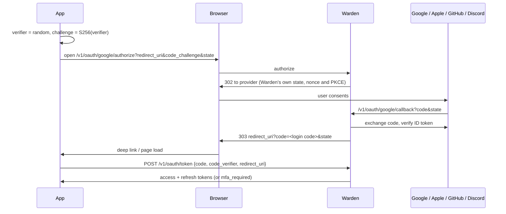

# Integration guide

How to use a Warden instance from web apps, mobile apps and backend services. Examples assume Warden runs at `https://auth.example.com` with the default audience `warden`; the admin UI's **Integrate** page shows the exact values for your instance.

- [Concepts](#concepts)
- [JavaScript and TypeScript SDK](#javascript-and-typescript-sdk)
- [API keys](#api-keys)
- [Backend services: verifying tokens](#backend-services-verifying-tokens)
- [Server API](#server-api)
- [Web apps](#web-apps)
- [Mobile apps](#mobile-apps)
- [Social sign-in, step by step](#social-sign-in-step-by-step)
- [Setting up identity providers](#setting-up-identity-providers)
- [Webhooks](#webhooks)
- [Consuming events](#consuming-events)
- [GraphQL](#graphql)
- [gRPC from other services](#grpc-from-other-services)
- [Error handling](#error-handling)

## Concepts

| Token | Lifetime | Where it lives | Used for |
| --- | --- | --- | --- |
| Access token (JWT, ES256) | 15 minutes | Memory | `Authorization: Bearer` on every API call |
| Refresh token (opaque) | 30 days idle, 90 days max | Secure storage (mobile) or HttpOnly cookie (web) | `POST /v1/auth/refresh` only |

Every refresh returns a **new** refresh token and invalidates the old one. If an old refresh token is presented again more than 10 seconds after it was rotated, Warden assumes it was stolen and revokes the whole session. Clients must therefore:

1. Store the new refresh token from every refresh response.
2. Never run two refreshes in parallel. Use one in-flight refresh promise that all requests wait on.

## JavaScript and TypeScript SDK

[`warden-auth`](https://www.npmjs.com/package/warden-auth) wraps everything below for browsers, React Native and Node.js: sign-in, MFA, single-flight token refresh, profile, photo upload, sessions, linked accounts, PKCE social sign-in, plus `warden-auth/server` for token verification, role checks, the server API and webhook signatures. Zero dependencies. Source and runnable example screens: [github.com/fatihacan1/warden-js](https://github.com/fatihacan1/warden-js).

```bash
npm install warden-auth
```

The admin UI's **API docs** page shows each example with your instance's URLs filled in.

## API keys

Create them on the admin UI's **API keys** page.

| | Publishable key | Secret key |
| --- | --- | --- |
| Prefix | `pk_live_` / `pk_test_` | `sk_live_` / `sk_test_` |
| Lives in | Web and mobile apps | Your backends' secret store |
| Sent as | `X-Warden-Key` header (`client_key` query on `/authorize`) | `Authorization: Bearer` to `/v1/server/*` and `/graphql` |
| Proves | Which app is calling; bound origins are enforced and added to CORS | That a trusted backend is calling |
| If leaked | Harmless on its own: user data still needs a user's tokens | Revoke it immediately |

A publishable key is not a password. Anything shipped to a browser or phone can be read, so Warden never trusts it with data; it lets you lock the API to your apps' origins, see which app is calling, and reject unknown clients once **Require a publishable key** is on. Secret keys are hashed at rest, rate limited per key, and rejected on any request that carries a browser `Origin` header so they cannot be used from a web page by mistake.

## Backend services: verifying tokens

Verify access tokens locally with the public keys at `/.well-known/jwks.json`. Libraries cache the keys and refetch them when Warden rotates its signing key.

Always check: algorithm `ES256`, `typ` = `at+jwt`, issuer, audience and expiry.

### Node.js (Express, Fastify, Nest, ...)

```js
import { createRemoteJWKSet, jwtVerify } from "jose";

const ISSUER = "https://auth.example.com";
const JWKS = createRemoteJWKSet(new URL(`${ISSUER}/.well-known/jwks.json`));

export async function requireAuth(req, res, next) {
  const token = req.headers.authorization?.replace(/^Bearer /i, "");
  if (!token) return res.status(401).json({ error: "unauthorized" });
  try {
    const { payload } = await jwtVerify(token, JWKS, {
      issuer: ISSUER,
      audience: "warden",
      algorithms: ["ES256"],
      typ: "at+jwt",
    });
    req.user = {
      id: payload.sub,
      sessionId: payload.sid,
      email: payload.email,
      emailVerified: payload.email_verified,
      roles: payload.roles ?? [],
    };
    next();
  } catch {
    res.status(401).json({ error: "invalid_token" });
  }
}

export const requireRole = (role) => (req, res, next) =>
  req.user?.roles.includes(role) ? next() : res.status(403).json({ error: "forbidden" });
```

### Go

```go
import (
    "github.com/MicahParks/keyfunc/v3"
    "github.com/golang-jwt/jwt/v5"
)

jwks, err := keyfunc.NewDefault([]string{"https://auth.example.com/.well-known/jwks.json"})

claims := jwt.MapClaims{}
token, err := jwt.ParseWithClaims(raw, claims, jwks.Keyfunc,
    jwt.WithValidMethods([]string{"ES256"}),
    jwt.WithIssuer("https://auth.example.com"),
    jwt.WithAudience("warden"),
    jwt.WithExpirationRequired())
if err != nil || token.Header["typ"] != "at+jwt" {
    // 401
}
```

### Python (FastAPI, Django)

```python
import jwt  # PyJWT

jwks = jwt.PyJWKClient("https://auth.example.com/.well-known/jwks.json")

def verify(token: str) -> dict:
    if jwt.get_unverified_header(token).get("typ") != "at+jwt":
        raise jwt.InvalidTokenError("wrong token type")
    key = jwks.get_signing_key_from_jwt(token).key
    return jwt.decode(token, key, algorithms=["ES256"],
                      audience="warden", issuer="https://auth.example.com")
```

### Revocation

Access tokens stay valid until they expire (15 minutes by default) even if the session is revoked. That is the trade-off that makes offline verification fast. For sensitive actions (payments, deleting data, changing email) ask Warden directly: `VerifyAccessToken` over gRPC with `check_session: true`, or `GET /v1/me` over HTTP, both reject revoked sessions immediately.

### Roles

`roles` is a list of lowercase strings set through the admin UI or gRPC `SetUserRoles`. Compare exact values (`roles.includes("admin")`), never substrings. New roles appear in the next access token, so within one access token lifetime.

## Server API

Backends that need to manage users call `/v1/server` with a secret key:

| Method | Path | Purpose |
| --- | --- | --- |
| POST | `/v1/server/users` | Create a user (email, optional password, name, roles, `email_verified`). Works when sign-ups are off: this is how you create the first admin |
| GET | `/v1/server/users?email=` | Find a user by email |
| GET, PATCH | `/v1/server/users/{id}` | Read; change name, roles or disabled state |
| DELETE | `/v1/server/users/{id}/sessions` | Sign the user out everywhere |
| POST | `/v1/server/tokens/verify` | Introspect an access token; `check_session: true` also checks revocation and returns current roles |

```bash
curl -X POST https://auth.example.com/v1/server/users \
  -H "Authorization: Bearer $WARDEN_SECRET_KEY" -H "Content-Type: application/json" \
  -d '{"email":"ada@example.com","password":"correct horse battery staple","roles":["admin"],"email_verified":true}'
```

## Service-to-service

Microservices that call each other should not share user tokens or one long-lived API key. Give each service a **service client** (admin UI, *Developers > Service clients*) and let it trade its credentials for a short-lived access token with the OAuth 2.0 client credentials grant ([RFC 6749 section 4.4](https://datatracker.ietf.org/doc/html/rfc6749#section-4.4)). The receiving service verifies the token offline with the same JWKS it uses for user tokens.

```
orders-service ── client_id + client_secret ──▶ Warden  POST /v1/oauth/token
orders-service ◀── access_token (15 min) ────── Warden
orders-service ── Authorization: Bearer … ────▶ billing-service ── verifies with the JWKS, no call to Warden
```

A client has a name, the **scopes** and **audiences** it may ask for, and a token lifetime (default 15 minutes, at most 1 hour). The client ID looks like `svc_…`; the secret (`wcs_…`) is shown once and stored as a SHA-256 hash.

```bash
curl -u "$CLIENT_ID:$CLIENT_SECRET" \
  -d grant_type=client_credentials \
  -d scope="invoices:read invoices:write" \
  -d audience=billing-api \
  https://auth.example.com/v1/oauth/token
```

```json
{ "access_token": "eyJ…", "token_type": "Bearer", "expires_in": 900, "scope": "invoices:read invoices:write" }
```

- **Authentication**: HTTP Basic (`client_secret_basic`, preferred) or `client_id` and `client_secret` in the body (`client_secret_post`). Not both. The body is `application/x-www-form-urlencoded` as the RFC says; JSON works too.
- **`scope`** is a space separated subset of the client's allowed scopes; omitted, the client gets all of them. Scope names are yours (`invoices:read`).
- **`audience`** (or `resource`, [RFC 8707](https://datatracker.ietf.org/doc/html/rfc8707)) must be in the client's allowed list; omitted, the first one is used. A token has the audiences you asked for, so it is useless against a service you did not name. A new client without an explicit list is allowed `TOKEN_AUDIENCE`.
- There is **no refresh token**. Ask again when `expires_in` runs out (the SDKs cache the token and do this for you).
- Errors follow RFC 6749 section 5.2: `{"error":"invalid_client"}` (401) for an unknown client, a wrong secret and a revoked client alike, `invalid_scope`, `invalid_target`, `invalid_request`, `unsupported_grant_type` (400). Requests are rate limited per client (`RATE_LIMIT_CLIENT_TOKEN_PER_MINUTE`) and per IP (`RATE_LIMIT_CLIENT_TOKEN_IP_PER_MINUTE`), and every issued token and failed attempt is in the audit log.

### What is in the token

An ES256 JWT with `typ: at+jwt` ([RFC 9068](https://datatracker.ietf.org/doc/html/rfc9068)):

```json
{ "iss": "https://auth.example.com", "sub": "client:svc_Zk3vN9aQ2xTt", "client_id": "svc_Zk3vN9aQ2xTt",
  "scope": "invoices:read invoices:write", "aud": ["billing-api"], "iat": 1767225600, "exp": 1767226500, "jti": "…" }
```

There is no `sid`, `email` or `roles`: it identifies a service, never a user. Warden's own user endpoints (`/v1/me/...`) and GraphQL refuse it.

### Verifying it in the receiving service

Same as a user token (see above): check the signature with the JWKS, `typ`, issuer and **your own audience**, then authorize on `scope`. Tell the two kinds apart with `client_id` (present only on service tokens) or the `client:` prefix of `sub`.

```ts
import { createWardenServer, isServiceToken } from "@warden/server";

const warden = createWardenServer({ url: "https://auth.example.com", audience: "billing-api", secretKey: process.env.WARDEN_SECRET_KEY });
app.use("/internal", warden.middleware({ scopes: ["invoices:read"] })); // machine tokens must carry these scopes
```

```go
// golang-jwt: after verifying, read the extra claims.
type claims struct {
    jwt.RegisteredClaims
    ClientID string `json:"client_id"`
    Scope    string `json:"scope"`
}
// authorize: slices.Contains(strings.Fields(c.Scope), "invoices:read")
```

For an online check, `POST /v1/server/tokens/verify` (secret key) understands service tokens. It answers `{"active": true, "token_type": "service", "client_id": "…", "scope": "…", "aud": […]}`, and `{"active": false, "reason": "client_revoked"}` as soon as the client is revoked. The gRPC `VerifyAccessToken` returns `valid: false, reason: "service_token"` for them, since the response has no place for a client.

### Rotating a secret without downtime

*Rotate secret* in the admin UI creates a new secret and keeps the **old one valid for 1 or 24 hours** (or ends it at once). Deploy the new secret to the service during that window; the old one stops by itself. Rotating twice in a row replaces the old secret, so only the latest previous secret has a grace period. Revoking a client stops new tokens at once; tokens already issued stay valid until they expire (at most the client's token lifetime, 15 minutes by default), and online introspection refuses them immediately.

## Web apps

Use **cookie mode**: send `X-Auth-Mode: cookie` on sign-up, sign-in, MFA, token exchange, refresh and sign-out. Warden then puts the refresh token in an HttpOnly cookie scoped to `/v1/auth` and leaves it out of the JSON. Keep the access token in memory only (not `localStorage`).

```js
const AUTH = "https://auth.example.com";
let accessToken = null;
let refreshing = null;

async function signIn(email, password) {
  const r = await fetch(`${AUTH}/v1/auth/signin`, {
    method: "POST",
    credentials: "include",
    headers: { "Content-Type": "application/json", "X-Auth-Mode": "cookie" },
    body: JSON.stringify({ email, password }),
  });
  const body = await r.json();
  if (body.status === "mfa_required") return body;   // ask for the code, then POST /v1/auth/mfa/verify
  accessToken = body.tokens.access_token;
  return body;
}

// One refresh at a time, shared by every caller.
function refresh() {
  refreshing ??= fetch(`${AUTH}/v1/auth/refresh`, {
    method: "POST",
    credentials: "include",
    headers: { "X-Auth-Mode": "cookie" },
  })
    .then((r) => (r.ok ? r.json() : Promise.reject(r)))
    .then((b) => (accessToken = b.tokens.access_token))
    .finally(() => (refreshing = null));
  return refreshing;
}
```

Requirements for cookie mode:

- Add the web app origin to **CORS origins** (admin UI > Settings, or `HTTP_CORS_ALLOWED_ORIGINS`).
- Serve Warden over HTTPS (`HTTP_COOKIE_SECURE=true`).
- If the app and Warden are on different sites (not just subdomains), set `HTTP_COOKIE_SAME_SITE=None`. On the same site (`app.example.com` and `auth.example.com`) the default `Lax` works.

The custom header is the CSRF defense: browsers cannot send it cross-origin without a CORS preflight, and Warden ignores the cookie without it.

## Mobile apps

Store the refresh token in the Keychain (iOS) or EncryptedSharedPreferences / Keystore (Android). Do not send `X-Auth-Mode`; tokens come back in the JSON body.

Two ways to offer social sign-in:

1. **Native SDK sign-in** for Apple and Google. Best user experience; no browser.
2. **Browser flow** for every provider, with `ASWebAuthenticationSession` (iOS) or Custom Tabs (Android) and your app's URL scheme.

### Native Sign in with Apple (iOS)

```swift
let rawNonce = randomString(32)                       // keep it
let request = ASAuthorizationAppleIDProvider().createRequest()
request.requestedScopes = [.fullName, .email]
request.nonce = sha256Hex(rawNonce)                   // Apple embeds the hash in the ID token
// ...on success:
let idToken = String(data: credential.identityToken!, encoding: .utf8)!
let name = [credential.fullName?.givenName, credential.fullName?.familyName].compactMap { $0 }.joined(separator: " ")

POST https://auth.example.com/v1/oauth/apple/native
{ "id_token": idToken, "nonce": rawNonce, "name": name }
```

Add your app's bundle ID to **App bundle IDs** in the Apple provider settings. Apple shares the user's name only on the first sign-in, which is why the app sends it.

### Native Google Sign-In (Android Credential Manager / iOS)

```kotlin
val nonce = randomString(32)
val option = GetGoogleIdOption.Builder()
    .setServerClientId(WEB_CLIENT_ID)   // the Web client ID configured in Warden
    .setNonce(nonce)
    .build()
// ...on success:
POST https://auth.example.com/v1/oauth/google/native
{ "id_token": googleIdTokenCredential.idToken, "nonce": nonce }
```

If the ID token's audience is an Android or iOS client ID instead of the web client ID, add it to **Native client IDs** in the Google provider settings.

Native sign-in requires a nonce of at least 16 characters, and each nonce works once. This stops a leaked ID token from being replayed.

## Social sign-in, step by step

The browser flow works for web and mobile and for every provider.



1. Generate a PKCE pair in the app: `code_verifier` (43-128 random URL-safe chars) and `code_challenge = base64url(sha256(verifier))`.
2. Open `GET /v1/oauth/{provider}/authorize` with `redirect_uri`, `code_challenge`, `code_challenge_method=S256` and an optional `state` the app checks later.
3. The app receives `redirect_uri?code=...&state=...`, or `?error=...&state=...` (`access_denied`, `email_taken`, `signup_disabled`, `account_disabled`, `provider_error`, `server_error`).
4. Exchange within 60 seconds: `POST /v1/oauth/token` with `{"code", "code_verifier", "redirect_uri"}`. The response is the same as a password sign-in, including `mfa_required` for users with two-factor authentication.

`redirect_uri` must exactly match an entry in **Allowed redirect URIs**, for example `https://app.example.com/auth/callback` or `myapp://auth/callback`.

### Account linking rules

- A returning provider identity always maps to the same user.
- If the provider says the email is **verified** and a user with that email exists, the identity is linked to that user. If that user had never verified the email, its password is removed and its sessions revoked: whoever set it never proved they own the address.
- If the provider's email is **not verified** and the email is taken, sign-in fails with `email_taken`.
- Otherwise a new user is created (unless sign-ups are disabled).

## Setting up identity providers

Open the admin UI, **Sign-in providers**. Each card shows the callback URL to register and a link to the provider's console.

**Google**: Google Cloud Console > APIs & Services > Credentials > Create OAuth client ID > *Web application*. Add the callback URL as an authorized redirect URI. Paste the client ID and secret. For native apps also create Android/iOS clients and list their IDs under *Native client IDs*.

**Apple**: Apple Developer > Identifiers: create an App ID with *Sign in with Apple*, then a *Services ID* (this is the client ID) with the callback URL as Return URL. Keys: create a key with *Sign in with Apple*, download the `.p8`. Paste the Services ID, Team ID, Key ID and the full `.p8` contents. List your iOS bundle IDs for native sign-in. Apple requires HTTPS callback URLs, so test the browser flow on a deployed instance or through a tunnel.

**GitHub**: Settings > Developer settings > OAuth Apps > New. Set the callback URL. Paste the client ID and a generated client secret. Only the primary, verified email is trusted.

**Discord**: Developer Portal > Applications > OAuth2. Add the callback URL as a redirect, paste the client ID and secret. Unverified Discord emails are never trusted for linking.

Providers can also be configured with `OAUTH_*` environment variables; settings saved in the admin UI take precedence.

## Webhooks

Add endpoints on the admin UI's **Webhooks** page and pick the events they receive (for example `user.created` and `user.updated`). Each event is POSTed as JSON, the same envelope as RabbitMQ, with three headers from the [Standard Webhooks](https://www.standardwebhooks.com) specification:

```
webhook-id: 0199f3c2-8a7e-7b1c-9d2e-4f5a6b7c8d9e
webhook-timestamp: 1761128450
webhook-signature: v1,<base64 HMAC-SHA256 of "id.timestamp.body">
```

Verify before trusting the body. With the SDK:

```js
import { verifyWebhook } from "warden-auth/server";

app.post("/webhooks/warden", express.raw({ type: "application/json" }), async (req, res) => {
  const event = await verifyWebhook({ secret: process.env.WARDEN_WEBHOOK_SECRET, headers: req.headers, body: req.body });
  if (event.type === "user.created") await createProfile(event.user_id, event.data.email);
  res.sendStatus(204);
});
```

Any Standard Webhooks library works too (`standardwebhooks` for Node, Python, Go, Ruby, PHP, Java, Rust). Rules for receivers:

- Use the raw body for verification, not re-serialized JSON.
- Reject timestamps more than 5 minutes off; the SDK does.
- Answer `2xx` quickly. Other answers are retried with exponential backoff for about five hours, then the delivery is marked failed; `410 Gone` stops it at once. Failed deliveries can be retried from the admin UI.
- Deliveries are at-least-once and can arrive out of order: deduplicate on `id` and compare `occurred_at`.

Every endpoint has its own queue: a slow receiver never delays another one or RabbitMQ. In production, webhook URLs must be `https://` and resolve to public addresses (private networks, loopback and cloud metadata addresses are blocked, also after DNS resolution).

## Consuming events

When `RABBITMQ_URL` is set, Warden publishes to the topic exchange `warden.events` with the event type as routing key. Messages are persistent and published with confirms.

```json
{
  "id": "0199f3c2-8a7e-7b1c-9d2e-4f5a6b7c8d9e",
  "type": "user.created",
  "occurred_at": "2026-10-22T10:20:50Z",
  "user_id": "01a16320-b47f-7e62-956f-83711f6428eb",
  "data": { "email": "ada@example.com", "method": "password" }
}
```

Bind a queue per consuming service:

```js
import amqp from "amqplib";

const conn = await amqp.connect(process.env.RABBITMQ_URL);
const ch = await conn.createChannel();
const { queue } = await ch.assertQueue("billing.warden-events", { durable: true });
await ch.bindQueue(queue, "warden.events", "user.created");
await ch.bindQueue(queue, "warden.events", "user.deleted");
ch.consume(queue, async (msg) => {
  const event = JSON.parse(msg.content.toString());
  if (await alreadyProcessed(event.id)) return ch.ack(msg);   // at-least-once delivery
  await handle(event);
  ch.ack(msg);
});
```

Events are written in the same database transaction as the change that caused them, so they are never lost and never published for a change that was rolled back. If RabbitMQ is down they wait in the outbox and are delivered when it returns.

## GraphQL

With `GRAPHQL_ENABLED=true`, `POST /graphql` serves the account API: `me`, `sessions`, `identities`, `providers`, and the mutations `updateProfile`, `revokeSession`, `revokeOtherSessions`, `unlinkIdentity`. With a secret key, `user(id)` and `setUserRoles` are available to backends. Sign-in, refresh and sign-out stay on REST, where cookies and token rotation are handled.

```bash
curl -X POST https://auth.example.com/graphql -H "Authorization: Bearer $ACCESS_TOKEN" \
  -H "Content-Type: application/json" -d '{"query":"{ me { id name roles } sessions { id current userAgent } }"}'
```

Protections: JSON POST only (no GET, no form posts, so no CSRF through simple requests), one operation per request (no batching), query length limit (`GRAPHQL_MAX_QUERY_LENGTH`), depth limit (`GRAPHQL_MAX_DEPTH`), bounded parallelism, fragment overlap limits, introspection off in production, per-IP rate limit, and errors reduced to Warden's codes in `extensions.code`.

## gRPC from other services

The gRPC API is for trusted backends on a private network. Enable it with `GRPC_ENABLED=true` and give each service its own key in `GRPC_API_KEYS`.

```go
import wardenv1 "github.com/fatihacan1/warden/pkg/api/wardenv1"

conn, _ := grpc.NewClient("warden:9091", grpc.WithTransportCredentials(insecure.NewCredentials()))
client := wardenv1.NewAuthServiceClient(conn)
ctx := metadata.AppendToOutgoingContext(ctx, "x-api-key", os.Getenv("WARDEN_API_KEY"))

res, err := client.VerifyAccessToken(ctx, &wardenv1.VerifyAccessTokenRequest{
    AccessToken: token, CheckSession: true,
})
if err != nil || !res.Valid { /* reject */ }
```

Other languages: generate a client from [api/proto/warden/v1/warden.proto](../api/proto/warden/v1/warden.proto). With `GRPC_REFLECTION=true`, `grpcurl` can explore the API:

```bash
grpcurl -plaintext -H "x-api-key: $KEY" localhost:9091 list warden.v1.AuthService
```

### TLS and mutual TLS

Set `GRPC_TLS_CERT_FILE` and `GRPC_TLS_KEY_FILE` and the port serves TLS 1.3 (older versions are refused). Add `GRPC_TLS_CLIENT_CA_FILE` and clients must also present a certificate signed by that CA, or the handshake fails: that is mutual TLS. The API key is still required on top of it, unless you set `GRPC_MTLS_ONLY=true`, which accepts a verified client certificate instead of a key (`GRPC_API_KEYS` may then be empty). Startup fails if a file is unreadable, the key does not match the certificate, or the CA has no certificate.

```bash
# server config
GRPC_TLS_CERT_FILE=/etc/warden/tls/server.pem
GRPC_TLS_KEY_FILE=/etc/warden/tls/server.key
GRPC_TLS_CLIENT_CA_FILE=/etc/warden/tls/clients-ca.pem
GRPC_MTLS_ONLY=true
```

```go
cert, _ := tls.LoadX509KeyPair("orders.pem", "orders.key")
roots := x509.NewCertPool()
roots.AppendCertsFromPEM(serverCA) // the CA that signed the Warden server certificate
creds := credentials.NewTLS(&tls.Config{Certificates: []tls.Certificate{cert}, RootCAs: roots, ServerName: "warden.internal", MinVersion: tls.VersionTLS13})
conn, _ := grpc.NewClient("warden.internal:9091", grpc.WithTransportCredentials(creds))
```

Certificates for a test setup (a private CA, a server certificate and one client certificate), with OpenSSL:

```bash
openssl req -x509 -newkey ec -pkeyopt ec_paramgen_curve:prime256v1 -nodes -days 365 \
  -keyout ca.key -out ca.pem -subj "/CN=warden-test-ca"

# server (the name clients connect to must be in the SAN)
openssl req -newkey ec -pkeyopt ec_paramgen_curve:prime256v1 -nodes -keyout server.key -out server.csr -subj "/CN=warden.internal"
openssl x509 -req -in server.csr -CA ca.pem -CAkey ca.key -CAcreateserial -days 90 -out server.pem \
  -extfile <(printf "subjectAltName=DNS:warden.internal,DNS:localhost,IP:127.0.0.1\nextendedKeyUsage=serverAuth")

# one client
openssl req -newkey ec -pkeyopt ec_paramgen_curve:prime256v1 -nodes -keyout orders.key -out orders.csr -subj "/CN=orders-service"
openssl x509 -req -in orders.csr -CA ca.pem -CAkey ca.key -CAcreateserial -days 90 -out orders.pem \
  -extfile <(printf "extendedKeyUsage=clientAuth")

grpcurl -cacert ca.pem -cert orders.pem -key orders.key -servername warden.internal localhost:9091 list
```

For production use a real CA (Vault PKI, cert-manager, your service mesh) with short-lived certificates. The server reads its certificate files at startup, so restart (or roll) Warden after renewing them. `internal/transport/grpcapi/mtls_test.go` generates a CA and certificates in Go with `crypto/x509` if you prefer code to OpenSSL.

## Error handling

All errors share one shape:

```json
{ "error": { "code": "rate_limited", "message": "Too many requests. Please try again later.", "request_id": "..." } }
```

Branch on `code`, show `message` to users if you like (it never reveals whether an account exists), and log `request_id` for support. Common codes:

| Code | HTTP | Meaning |
| --- | --- | --- |
| `validation_failed`, `weak_password`, `breached_password` | 422 | Fix the input; `fields` may name the field |
| `invalid_credentials` | 401 | Wrong email or password |
| `invalid_token` | 401 | Access, refresh, reset or login code invalid or expired. For refresh: sign the user out |
| `invalid_mfa_code` | 401 | Wrong TOTP or recovery code |
| `email_not_verified`, `account_disabled`, `signup_disabled` | 403 | Account state |
| `reauthentication_required` | 403 | Social-only user must sign in again before a sensitive change |
| `email_taken` | 409 | Email already registered |
| `invalid_publishable_key`, `origin_not_allowed` | 401, 403 | Missing or unknown `X-Warden-Key`, or the key is used from an origin it is not bound to |
| `invalid_secret_key`, `secret_key_in_browser` | 401, 403 | Server API called without a valid secret key, or from a browser |
| `rate_limited` | 429 | Respect `Retry-After` |
| `server_busy`, `service_unavailable` | 503 | Retry after `Retry-After` with backoff |

## Admin API and AI agents

Create an access token on the admin UI's **Access tokens** page. Choose read or write per resource (users, email templates, settings, webhooks, API keys, providers, audit log, statistics), a lifetime from 1 hour to 90 days, and optionally the IP ranges it may be used from. The token is shown once.

The admin API lives on the admin port under `/api/v1` and takes `Authorization: Bearer wat_...`. The admin UI's **API docs** page lists every endpoint with the permission it needs. Examples:

```bash
curl http://localhost:9090/api/v1/users?q=ada -H "Authorization: Bearer $WARDEN_ACCESS_TOKEN"
curl -X PATCH http://localhost:9090/api/v1/users/$ID -H "Authorization: Bearer $WARDEN_ACCESS_TOKEN" \
  -H "Content-Type: application/json" -d '{"roles":["admin"]}'
```

For Claude and other MCP clients, Warden includes an MCP server that turns the API into tools (list users, edit an email template, create a webhook, ...), offering only those the token allows:

```bash
claude mcp add warden -e WARDEN_ADMIN_URL=http://localhost:9090 -e WARDEN_ACCESS_TOKEN=wat_... -- warden mcp
```

Guarantees: tokens always expire, are stored as hashes and checked on every request (revocation is immediate), cannot create other tokens or change the admin IP allowlist, are refused on requests from browsers, are limited to 300 requests per minute, and every change they make is in the audit log with the token's name.

## Languages and security emails

Every email goes out in the user's language. Built in: English (`en`) and Turkish (`tr`). A user's language is, in order:

1. what your app sets: `locale` on `POST /v1/auth/signup`, `PATCH /v1/me {"locale": "tr"}`, or the server API (`locale` on create and update);
2. on sign-up without one, the best match of the browser's `Accept-Language`;
3. otherwise the instance default (Settings > Language, or `AUTH_DEFAULT_LOCALE`).

`locale` is returned on the user object so your app can show it. Wording and design are edited per language on the admin UI's **Emails** page.

Security emails, all optional except the first two:

| Email | When |
| --- | --- |
| Password changed | Password changed or reset |
| Two-factor changed | TOTP turned on or off |
| Sign-in from a new device | The first sign-in from a browser or app (by browser/app family and operating system) the account has not used in 180 days. Never for the first device of an account. At most 3 per account per hour. Contains device, IP, country when a trusted proxy reports it (`CF-IPCountry` and similar), method and time, and a link that ends that session after a confirmation click (mail scanners open links, so the link alone never signs anyone out). |
| Account locked | Once, when wrong passwords reach the lockout threshold |
