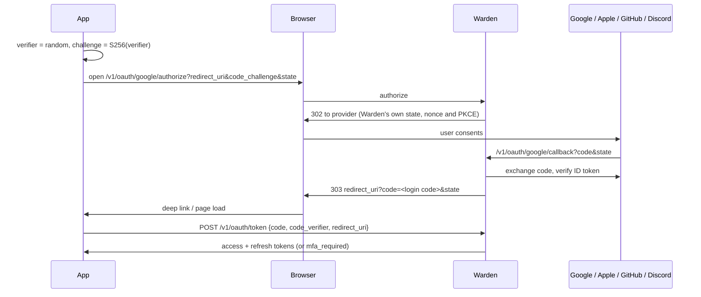

# Integration guide

How to use a Warden instance from web apps, mobile apps and backend services. Examples assume Warden runs at `https://auth.example.com` with the default audience `warden`; the admin UI's **Integrate** page shows the exact values for your instance.

- [Concepts](#concepts)
- [Backend services: verifying tokens](#backend-services-verifying-tokens)
- [Web apps](#web-apps)
- [Mobile apps](#mobile-apps)
- [Social sign-in, step by step](#social-sign-in-step-by-step)
- [Setting up identity providers](#setting-up-identity-providers)
- [Consuming events](#consuming-events)
- [gRPC from other services](#grpc-from-other-services)
- [Error handling](#error-handling)

## Concepts

| Token | Lifetime | Where it lives | Used for |
| --- | --- | --- | --- |
| Access token (JWT, ES256) | 15 minutes | Memory | `Authorization: Bearer` on every API call |
| Refresh token (opaque) | 30 days idle, 90 days max | Secure storage (mobile) or HttpOnly cookie (web) | `POST /v1/auth/refresh` only |

Every refresh returns a **new** refresh token and invalidates the old one. If an old refresh token is presented again more than 10 seconds after it was rotated, Warden assumes it was stolen and revokes the whole session. Clients must therefore:

1. Store the new refresh token from every refresh response.
2. Never run two refreshes in parallel. Use one in-flight refresh promise that all requests wait on.

## Backend services: verifying tokens

Verify access tokens locally with the public keys at `/.well-known/jwks.json`. Libraries cache the keys and refetch them when Warden rotates its signing key.

Always check: algorithm `ES256`, `typ` = `at+jwt`, issuer, audience and expiry.

### Node.js (Express, Fastify, Nest, ...)

```js
import { createRemoteJWKSet, jwtVerify } from "jose";

const ISSUER = "https://auth.example.com";
const JWKS = createRemoteJWKSet(new URL(`${ISSUER}/.well-known/jwks.json`));

export async function requireAuth(req, res, next) {
  const token = req.headers.authorization?.replace(/^Bearer /i, "");
  if (!token) return res.status(401).json({ error: "unauthorized" });
  try {
    const { payload } = await jwtVerify(token, JWKS, {
      issuer: ISSUER,
      audience: "warden",
      algorithms: ["ES256"],
      typ: "at+jwt",
    });
    req.user = {
      id: payload.sub,
      sessionId: payload.sid,
      email: payload.email,
      emailVerified: payload.email_verified,
      roles: payload.roles ?? [],
    };
    next();
  } catch {
    res.status(401).json({ error: "invalid_token" });
  }
}

export const requireRole = (role) => (req, res, next) =>
  req.user?.roles.includes(role) ? next() : res.status(403).json({ error: "forbidden" });
```

### Go

```go
import (
    "github.com/MicahParks/keyfunc/v3"
    "github.com/golang-jwt/jwt/v5"
)

jwks, err := keyfunc.NewDefault([]string{"https://auth.example.com/.well-known/jwks.json"})

claims := jwt.MapClaims{}
token, err := jwt.ParseWithClaims(raw, claims, jwks.Keyfunc,
    jwt.WithValidMethods([]string{"ES256"}),
    jwt.WithIssuer("https://auth.example.com"),
    jwt.WithAudience("warden"),
    jwt.WithExpirationRequired())
if err != nil || token.Header["typ"] != "at+jwt" {
    // 401
}
```

### Python (FastAPI, Django)

```python
import jwt  # PyJWT

jwks = jwt.PyJWKClient("https://auth.example.com/.well-known/jwks.json")

def verify(token: str) -> dict:
    if jwt.get_unverified_header(token).get("typ") != "at+jwt":
        raise jwt.InvalidTokenError("wrong token type")
    key = jwks.get_signing_key_from_jwt(token).key
    return jwt.decode(token, key, algorithms=["ES256"],
                      audience="warden", issuer="https://auth.example.com")
```

### Revocation

Access tokens stay valid until they expire (15 minutes by default) even if the session is revoked. That is the trade-off that makes offline verification fast. For sensitive actions (payments, deleting data, changing email) ask Warden directly: `VerifyAccessToken` over gRPC with `check_session: true`, or `GET /v1/me` over HTTP, both reject revoked sessions immediately.

### Roles

`roles` is a list of lowercase strings set through the admin UI or gRPC `SetUserRoles`. Compare exact values (`roles.includes("admin")`), never substrings. New roles appear in the next access token, so within one access token lifetime.

## Web apps

Use **cookie mode**: send `X-Auth-Mode: cookie` on sign-up, sign-in, MFA, token exchange, refresh and sign-out. Warden then puts the refresh token in an HttpOnly cookie scoped to `/v1/auth` and leaves it out of the JSON. Keep the access token in memory only (not `localStorage`).

```js
const AUTH = "https://auth.example.com";
let accessToken = null;
let refreshing = null;

async function signIn(email, password) {
  const r = await fetch(`${AUTH}/v1/auth/signin`, {
    method: "POST",
    credentials: "include",
    headers: { "Content-Type": "application/json", "X-Auth-Mode": "cookie" },
    body: JSON.stringify({ email, password }),
  });
  const body = await r.json();
  if (body.status === "mfa_required") return body;   // ask for the code, then POST /v1/auth/mfa/verify
  accessToken = body.tokens.access_token;
  return body;
}

// One refresh at a time, shared by every caller.
function refresh() {
  refreshing ??= fetch(`${AUTH}/v1/auth/refresh`, {
    method: "POST",
    credentials: "include",
    headers: { "X-Auth-Mode": "cookie" },
  })
    .then((r) => (r.ok ? r.json() : Promise.reject(r)))
    .then((b) => (accessToken = b.tokens.access_token))
    .finally(() => (refreshing = null));
  return refreshing;
}
```

Requirements for cookie mode:

- Add the web app origin to **CORS origins** (admin UI > Settings, or `HTTP_CORS_ALLOWED_ORIGINS`).
- Serve Warden over HTTPS (`HTTP_COOKIE_SECURE=true`).
- If the app and Warden are on different sites (not just subdomains), set `HTTP_COOKIE_SAME_SITE=None`. On the same site (`app.example.com` and `auth.example.com`) the default `Lax` works.

The custom header is the CSRF defense: browsers cannot send it cross-origin without a CORS preflight, and Warden ignores the cookie without it.

## Mobile apps

Store the refresh token in the Keychain (iOS) or EncryptedSharedPreferences / Keystore (Android). Do not send `X-Auth-Mode`; tokens come back in the JSON body.

Two ways to offer social sign-in:

1. **Native SDK sign-in** for Apple and Google. Best user experience; no browser.
2. **Browser flow** for every provider, with `ASWebAuthenticationSession` (iOS) or Custom Tabs (Android) and your app's URL scheme.

### Native Sign in with Apple (iOS)

```swift
let rawNonce = randomString(32)                       // keep it
let request = ASAuthorizationAppleIDProvider().createRequest()
request.requestedScopes = [.fullName, .email]
request.nonce = sha256Hex(rawNonce)                   // Apple embeds the hash in the ID token
// ...on success:
let idToken = String(data: credential.identityToken!, encoding: .utf8)!
let name = [credential.fullName?.givenName, credential.fullName?.familyName].compactMap { $0 }.joined(separator: " ")

POST https://auth.example.com/v1/oauth/apple/native
{ "id_token": idToken, "nonce": rawNonce, "name": name }
```

Add your app's bundle ID to **App bundle IDs** in the Apple provider settings. Apple shares the user's name only on the first sign-in, which is why the app sends it.

### Native Google Sign-In (Android Credential Manager / iOS)

```kotlin
val nonce = randomString(32)
val option = GetGoogleIdOption.Builder()
    .setServerClientId(WEB_CLIENT_ID)   // the Web client ID configured in Warden
    .setNonce(nonce)
    .build()
// ...on success:
POST https://auth.example.com/v1/oauth/google/native
{ "id_token": googleIdTokenCredential.idToken, "nonce": nonce }
```

If the ID token's audience is an Android or iOS client ID instead of the web client ID, add it to **Native client IDs** in the Google provider settings.

Native sign-in requires a nonce of at least 16 characters, and each nonce works once. This stops a leaked ID token from being replayed.

## Social sign-in, step by step

The browser flow works for web and mobile and for every provider.



1. Generate a PKCE pair in the app: `code_verifier` (43-128 random URL-safe chars) and `code_challenge = base64url(sha256(verifier))`.
2. Open `GET /v1/oauth/{provider}/authorize` with `redirect_uri`, `code_challenge`, `code_challenge_method=S256` and an optional `state` the app checks later.
3. The app receives `redirect_uri?code=...&state=...`, or `?error=...&state=...` (`access_denied`, `email_taken`, `signup_disabled`, `account_disabled`, `provider_error`, `server_error`).
4. Exchange within 60 seconds: `POST /v1/oauth/token` with `{"code", "code_verifier", "redirect_uri"}`. The response is the same as a password sign-in, including `mfa_required` for users with two-factor authentication.

`redirect_uri` must exactly match an entry in **Allowed redirect URIs**, for example `https://app.example.com/auth/callback` or `myapp://auth/callback`.

### Account linking rules

- A returning provider identity always maps to the same user.
- If the provider says the email is **verified** and a user with that email exists, the identity is linked to that user. If that user had never verified the email, its password is removed and its sessions revoked: whoever set it never proved they own the address.
- If the provider's email is **not verified** and the email is taken, sign-in fails with `email_taken`.
- Otherwise a new user is created (unless sign-ups are disabled).

## Setting up identity providers

Open the admin UI, **Sign-in providers**. Each card shows the callback URL to register and a link to the provider's console.

**Google**: Google Cloud Console > APIs & Services > Credentials > Create OAuth client ID > *Web application*. Add the callback URL as an authorized redirect URI. Paste the client ID and secret. For native apps also create Android/iOS clients and list their IDs under *Native client IDs*.

**Apple**: Apple Developer > Identifiers: create an App ID with *Sign in with Apple*, then a *Services ID* (this is the client ID) with the callback URL as Return URL. Keys: create a key with *Sign in with Apple*, download the `.p8`. Paste the Services ID, Team ID, Key ID and the full `.p8` contents. List your iOS bundle IDs for native sign-in. Apple requires HTTPS callback URLs, so test the browser flow on a deployed instance or through a tunnel.

**GitHub**: Settings > Developer settings > OAuth Apps > New. Set the callback URL. Paste the client ID and a generated client secret. Only the primary, verified email is trusted.

**Discord**: Developer Portal > Applications > OAuth2. Add the callback URL as a redirect, paste the client ID and secret. Unverified Discord emails are never trusted for linking.

Providers can also be configured with `OAUTH_*` environment variables; settings saved in the admin UI take precedence.

## Consuming events

When `RABBITMQ_URL` is set, Warden publishes to the topic exchange `warden.events` with the event type as routing key. Messages are persistent and published with confirms.

```json
{
  "id": "0199f3c2-8a7e-7b1c-9d2e-4f5a6b7c8d9e",
  "type": "user.created",
  "occurred_at": "2026-10-22T10:20:50Z",
  "user_id": "01a16320-b47f-7e62-956f-83711f6428eb",
  "data": { "email": "ada@example.com", "method": "password" }
}
```

Bind a queue per consuming service:

```js
import amqp from "amqplib";

const conn = await amqp.connect(process.env.RABBITMQ_URL);
const ch = await conn.createChannel();
const { queue } = await ch.assertQueue("billing.warden-events", { durable: true });
await ch.bindQueue(queue, "warden.events", "user.created");
await ch.bindQueue(queue, "warden.events", "user.deleted");
ch.consume(queue, async (msg) => {
  const event = JSON.parse(msg.content.toString());
  if (await alreadyProcessed(event.id)) return ch.ack(msg);   // at-least-once delivery
  await handle(event);
  ch.ack(msg);
});
```

Events are written in the same database transaction as the change that caused them, so they are never lost and never published for a change that was rolled back. If RabbitMQ is down they wait in the outbox and are delivered when it returns.

## gRPC from other services

The gRPC API is for trusted backends on a private network. Enable it with `GRPC_ENABLED=true` and give each service its own key in `GRPC_API_KEYS`.

```go
import wardenv1 "github.com/fatihacan1/warden/pkg/api/wardenv1"

conn, _ := grpc.NewClient("warden:9091", grpc.WithTransportCredentials(insecure.NewCredentials()))
client := wardenv1.NewAuthServiceClient(conn)
ctx := metadata.AppendToOutgoingContext(ctx, "x-api-key", os.Getenv("WARDEN_API_KEY"))

res, err := client.VerifyAccessToken(ctx, &wardenv1.VerifyAccessTokenRequest{
    AccessToken: token, CheckSession: true,
})
if err != nil || !res.Valid { /* reject */ }
```

Other languages: generate a client from [api/proto/warden/v1/warden.proto](../api/proto/warden/v1/warden.proto). With `GRPC_REFLECTION=true`, `grpcurl` can explore the API:

```bash
grpcurl -plaintext -H "x-api-key: $KEY" localhost:9091 list warden.v1.AuthService
```

Use TLS (a service mesh or a TLS-terminating proxy) when gRPC traffic leaves a trusted network.

## Error handling

All errors share one shape:

```json
{ "error": { "code": "rate_limited", "message": "Too many requests. Please try again later.", "request_id": "..." } }
```

Branch on `code`, show `message` to users if you like (it never reveals whether an account exists), and log `request_id` for support. Common codes:

| Code | HTTP | Meaning |
| --- | --- | --- |
| `validation_failed`, `weak_password`, `breached_password` | 422 | Fix the input; `fields` may name the field |
| `invalid_credentials` | 401 | Wrong email or password |
| `invalid_token` | 401 | Access, refresh, reset or login code invalid or expired. For refresh: sign the user out |
| `invalid_mfa_code` | 401 | Wrong TOTP or recovery code |
| `email_not_verified`, `account_disabled`, `signup_disabled` | 403 | Account state |
| `reauthentication_required` | 403 | Social-only user must sign in again before a sensitive change |
| `email_taken` | 409 | Email already registered |
| `rate_limited` | 429 | Respect `Retry-After` |
| `server_busy`, `service_unavailable` | 503 | Retry after `Retry-After` with backoff |
