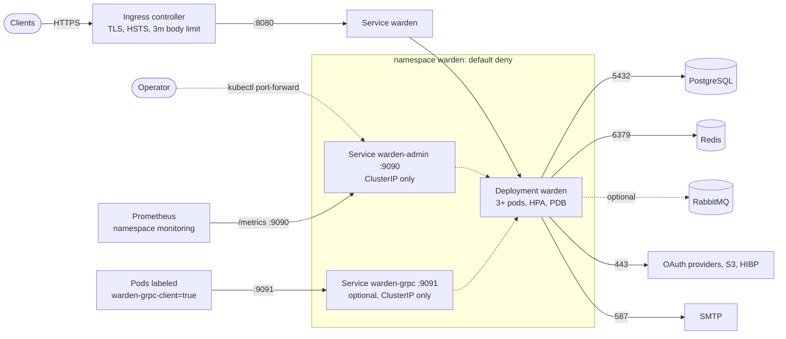

# Running Warden on Kubernetes

Manifests live in [deploy/kubernetes](../deploy/kubernetes) and use plain Kustomize (no Helm). They follow the Pod Security `restricted` profile, deny all traffic by default and expose only the public API.

```
deploy/kubernetes/
  base/                 Namespace, Deployment, Services, PDB, HPA, NetworkPolicies, Ingress
  components/monitoring ServiceMonitor + PrometheusRule (Prometheus Operator)
  components/direct-mail optional egress on port 25 (off by default)
  components/grpc       warden-grpc Service + NetworkPolicy, turns on GRPC_ENABLED
  overlays/dev          1 replica, in-cluster Postgres/Redis/Mailpit, no TLS (kind)
  overlays/production   3 replicas, external Postgres/Redis, TLS ingress, monitoring
  kind.yaml             kind cluster with ingress port mappings
```

## Architecture



Port 9090 (admin UI, `/metrics`) is never routed through the ingress. Warden is stateless, so replicas can be added and removed freely. Background jobs use Postgres advisory locks and the outbox uses `SKIP LOCKED`, so extra replicas never duplicate work.

## Prerequisites

- Kubernetes 1.30 or newer (the `preStop` sleep action is used; GA in 1.34, on by default since 1.30).
- `kubectl` (it bundles Kustomize) and, for the quick start, Docker and [kind](https://kind.sigs.k8s.io).
- Production: an ingress controller (examples use ingress-nginx), cert-manager with a `ClusterIssuer`, managed PostgreSQL and Redis, an SMTP provider, a CNI that enforces NetworkPolicy, and optionally the Prometheus Operator.

## Quick start on kind

Run from the repository root.

```bash
# 1. Build the image
docker build -t warden:k8s .

# 2. Create a cluster and load the image into it
kind create cluster --name warden --config deploy/kubernetes/kind.yaml
kind load docker-image warden:k8s --name warden

# 3. Create the secrets (gitignored). keygen prints ENCRYPTION_KEY and ADMIN_TOKEN.
cp deploy/kubernetes/overlays/dev/secrets.env.example deploy/kubernetes/overlays/dev/secrets.env
docker run --rm warden:k8s keygen
# Paste ENCRYPTION_KEY and ADMIN_TOKEN into overlays/dev/secrets.env and pick a
# POSTGRES_PASSWORD (use the same value inside DATABASE_URL).

# 4. Deploy
kubectl apply -k deploy/kubernetes/overlays/dev
kubectl -n warden rollout status deploy/warden

# 5. Use it (host ports 18081 and 19090 avoid clashing with Docker Compose)
kubectl -n warden port-forward svc/warden 18081:8080 &
kubectl -n warden port-forward svc/warden-admin 19090:9090 &
curl localhost:18081/readyz
curl -X POST localhost:18081/v1/auth/signup -H 'Content-Type: application/json' \
  -d '{"email":"me@example.com","password":"a-long-unique-password"}'
# Admin UI: http://localhost:19090/admin/login  (log in with ADMIN_TOKEN)

# Clean up
kind delete cluster --name warden
```

Mailpit (the dev mail catcher) is reachable with `kubectl -n warden port-forward svc/mailpit 18025:8025`.

To use the ingress on kind instead of port-forward, install ingress-nginx's kind manifest (`kubectl apply -f https://kind.sigs.k8s.io/examples/ingress/deploy-ingress-nginx.yaml`) and open `http://warden.localtest.me:18080`. The dev overlay sets `HTTP_PUBLIC_URL=http://localhost:18081`; change it in `overlays/dev/kustomization.yaml` if you use the ingress URL.

The dev overlay's Postgres and Redis have no backups and no high availability. They exist so you can try Warden; do not keep data in them.

## Production checklist

1. **Image.** Build and push a versioned image; set `images:` in `overlays/production/kustomization.yaml`. Pin the tag or digest, never `latest`.
2. **Settings.** Edit the `configMapGenerator` literals in the production overlay: `HTTP_PUBLIC_URL` (https), `HTTP_CORS_ALLOWED_ORIGINS`, `AUTH_ALLOWED_REDIRECT_URIS`, the email link URLs, `SMTP_*`. `APP_ENV=production` makes Warden refuse unsafe combinations at startup.
3. **`HTTP_TRUSTED_PROXIES`.** Set it to the addresses the ingress controller connects from: the ingress pods' CIDR if traffic arrives through a cloud load balancer in `externalTrafficPolicy: Cluster` mode with the client IP in `X-Forwarded-For`, otherwise the load balancer range. Too narrow and rate limiting sees the proxy's IP; too wide and clients can spoof their IP.
4. **Secrets.** Create `overlays/production/secrets.env` from the example for a first deploy, then move to External Secrets or Sealed Secrets (below).
5. **Datastores.** Point `DATABASE_URL` at managed PostgreSQL (`sslmode=verify-full`) and `REDIS_URL` at managed Redis (`rediss://`). Fix the CIDRs in `networkpolicy-datastores.yaml` to the real endpoints.
6. **Ingress.** Set the host, `ingressClassName` and the cert-manager issuer name. Keep HSTS on (ingress-nginx enables it by default for TLS hosts). Annotations are for ingress-nginx; translate them for other controllers.
7. **Network policy labels.** Base policies assume the ingress controller runs in a namespace named `ingress-nginx` and Prometheus in `monitoring`. If yours differ, edit the `kubernetes.io/metadata.name` values in `base/networkpolicy.yaml`.
8. **Monitoring.** The `monitoring` component needs the Prometheus Operator CRDs. If your Prometheus only selects resources with a release label, add it to the two resources. Alert rules are copied from `deploy/prometheus/alerts.yml`; keep them in sync.
9. **gRPC.** Uncomment `components/grpc` only if other services call Warden over gRPC; add `GRPC_API_KEYS` to the secrets, then label client pods `warden-grpc-client=true`.
10. **Direct mail.** Port 25 egress is closed by default. Add `../../components/direct-mail` to the overlay's `components:` only if Warden must deliver mail to MX servers itself.
11. **Check the render before applying.** `kubectl kustomize deploy/kubernetes/overlays/production | kubeconform -strict -ignore-missing-schemas`.

### Secrets in real clusters

`secretGenerator` plus a local `secrets.env` is only a bootstrap. Secrets in git or on a laptop are a liability, so in a real cluster:

- **External Secrets Operator.** Keep values in AWS Secrets Manager, GCP Secret Manager, Vault, etc., and create an `ExternalSecret` that produces a Secret named `warden-secrets` with the keys from `secrets.env.example`. Remove the `secretGenerator` block from the overlay, because the Deployment references `warden-secrets` by that name.
- **Sealed Secrets.** Run `kubeseal` on a Secret named `warden-secrets` and commit the `SealedSecret`; the same removal of `secretGenerator` applies.
- Back up `ENCRYPTION_KEY` separately. Losing it invalidates signing keys, TOTP seeds and provider secrets. Rotation: see [production.md](production.md#operations).

If you keep `secretGenerator`, Kustomize appends a content hash to the Secret name and rewrites references, so changing a secret rolls the pods automatically. With an external Secret, restart the Deployment (`kubectl rollout restart`) or use a reloader after rotating values.

## Network policy model

| Policy | Effect |
| --- | --- |
| `default-deny-all` | No ingress or egress for any pod in the namespace |
| `allow-dns` | Egress to DNS in `kube-system` |
| `warden-allow-public-http` | Port 8080 only from the ingress controller namespace |
| `warden-allow-admin` | Port 9090 only from pods labeled `warden-admin-access: "true"` and from the `monitoring` namespace |
| `warden-allow-grpc` (grpc component) | Port 9091 only from pods labeled `warden-grpc-client: "true"` |
| `warden-allow-egress-internet` | TCP 443 and SMTP relay ports (465, 587, 2525) to public addresses only (RFC 1918, link-local `169.254.0.0/16`, CGNAT `100.64.0.0/10`, `192.0.0.0/24` and `198.18.0.0/15` excluded) |
| `warden-allow-egress-smtp-25` (direct-mail component) | Optional. TCP 25 to public addresses, only for delivering straight to recipients' MX servers; leave off when you use an SMTP relay |
| `warden-allow-egress-datastores` (production) | Postgres/Redis by CIDR; replace the placeholders |
| dev overlay policies | Egress to the in-cluster Postgres, Redis and Mailpit by pod selector |

`kubectl port-forward` goes through the kubelet and is not affected by these policies, which is how you reach the admin UI from your laptop. Because private ranges are excluded from the internet rule, anything on a private IP (managed databases, a private S3 endpoint, an internal SMTP relay, RabbitMQ) needs its own CIDR rule. Webhooks to private addresses are also blocked by the policy, in line with `WEBHOOK_ALLOW_PRIVATE_NETWORKS` being off in production.

**NetworkPolicy is only enforced if the CNI implements it.** kind's default CNI (kindnet) and many minimal setups do not, so the policies are silently ignored there. Calico, Cilium and the managed offerings that bundle them (GKE Dataplane V2, EKS with the network policy agent or Calico, AKS with Azure/Calico/Cilium) do enforce them. To test enforcement on kind, set `networking.disableDefaultCNI: true` in `kind.yaml` and install Calico or Cilium.

## Scaling

- Each pod requests 250m CPU / 256 Mi and is limited to 1 CPU / 512 Mi. Argon2 uses 19 MiB per concurrent hash; `PASSWORD_MAX_CONCURRENT_HASHES=2` keeps one pod under the limit. If you raise CPU limits, raise it and the memory limit together (about 30 MiB + 19 MiB per hash), and keep `GOMEMLIMIT` near 90% of the limit.
- The HPA scales on CPU (70%), 3 to 12 pods in production. Password hashing dominates CPU, so this tracks sign-in load.
- Every pod opens up to `DATABASE_MAX_CONNS` (20) connections. Check `pods x 20` against the database `max_connections`, or put PgBouncer in front (use session pooling: migrations rely on session advisory locks).
- Pods spread across nodes and zones (soft constraints, so a small cluster still schedules). The PodDisruptionBudget allows one pod down at a time.
- Shutdown: `preStop` sleeps 10 s so the endpoint is removed before the server stops accepting, then Warden drains for up to `HTTP_SHUTDOWN_TIMEOUT` (20 s). `terminationGracePeriodSeconds` is 45. If you raise the shutdown timeout, raise the grace period too.

## Upgrades and migrations

Migrations run in an `initContainer` (`warden migrate`) and `DATABASE_AUTO_MIGRATE` is `false`. goose holds a Postgres advisory lock, so several pods starting together are safe, and an up-to-date schema makes it a no-op. An init container, instead of a Job, avoids Job immutability problems with GitOps tools and keeps the schema and the image in the same rollout.

Upgrade steps: change the tag in the overlay, `kubectl apply -k`, watch `kubectl -n warden rollout status deploy/warden`. Rollouts use `maxUnavailable: 0`, so capacity never drops. Migrations are forward-only; keep them backward compatible with the previous version for one release so a rollback (`kubectl rollout undo`) keeps working. Check state with `kubectl -n warden exec deploy/warden -c warden -- /warden migrate status` (needs no shell).

## Troubleshooting

| Symptom | Check |
| --- | --- |
| Pod `Init:CrashLoopBackOff` | `kubectl -n warden logs <pod> -c migrate`. Usually a wrong `DATABASE_URL`, an unreachable database (NetworkPolicy, security group) or TLS mode |
| Pod crashes with a config error | `kubectl -n warden logs <pod>`. Production rejects http URLs, insecure cookies, development secrets and a missing `SMTP_HOST` |
| Pod `CreateContainerConfigError` | The `warden-secrets` Secret is missing; create `secrets.env` and re-apply |
| Not ready | `GET /readyz` reports which of Postgres or Redis failed: `kubectl -n warden port-forward <pod> 18081:8080` then `curl localhost:18081/readyz` |
| `OOMKilled` | Raise the memory limit and `GOMEMLIMIT` together, or lower `PASSWORD_MAX_CONCURRENT_HASHES` |
| All clients share one IP, rate limits trip | `HTTP_TRUSTED_PROXIES` does not include the ingress source address |
| Ingress returns 413 on avatar upload | The body size annotation is not applied by your controller |
| Pods rejected on create | Pod Security `restricted` is enforced on the namespace; custom sidecars need the same `securityContext` |
| Works with kind, policies ignored | kindnet does not enforce NetworkPolicy; see above |
| Prometheus has no targets | Prometheus must be in a namespace labeled `kubernetes.io/metadata.name=monitoring`, and the ServiceMonitor must match its selector |
